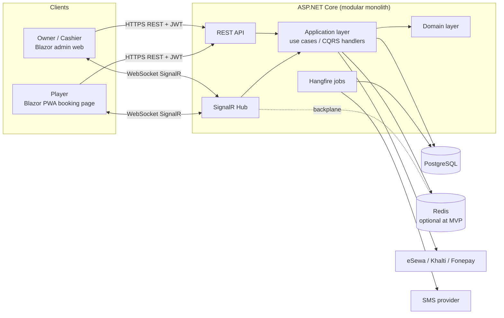
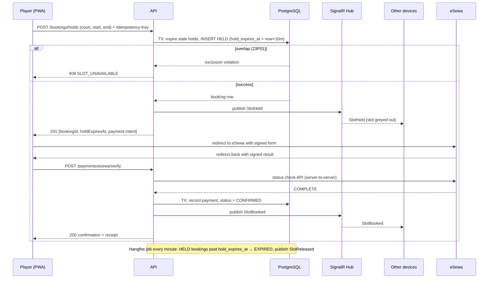
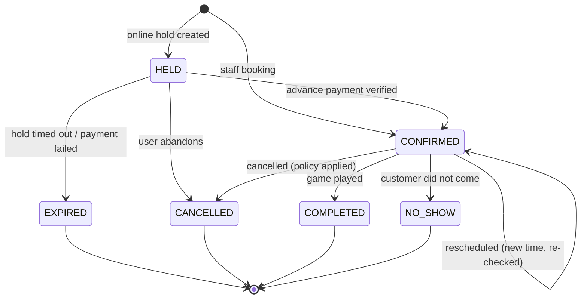
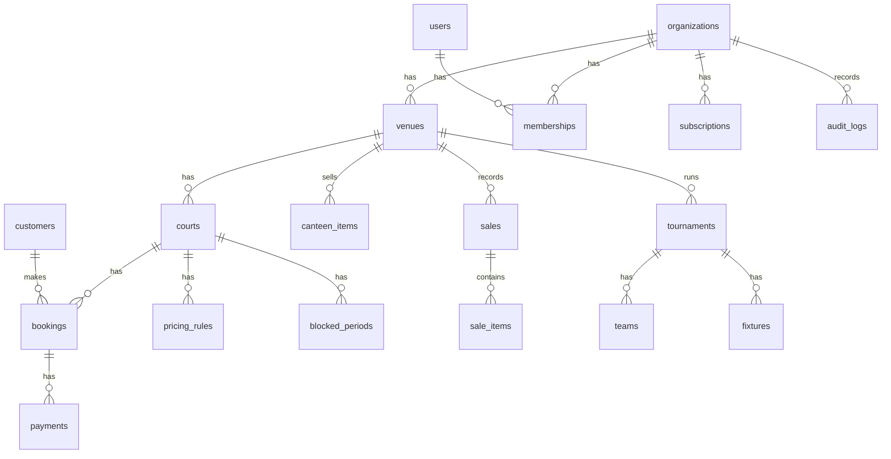

# FutsalPro — Futsal Management & Booking System (Nepal)

> **Instructions for the AI coding agent (Codex / ChatGPT):**
> Read this entire file before writing any code. It is the single source of truth for what we are building.
> Save a copy as `AGENTS.md` in the repo root so it is always loaded.
> Rules for you:
> 1. Follow the architecture, folder structure, and naming in this file. Do not invent a different stack.
> 2. Build in the milestone order in Section 18. Finish and test one milestone before starting the next.
> 3. The #1 rule of this product: **a court slot must never be double-booked, and a booked slot must instantly appear as booked on every other device.** Section 7 explains how. Do not weaken it.
> 4. If something is ambiguous, pick the simplest option, write the assumption in `docs/DECISIONS.md`, and continue.
> 5. Write tests for every business rule (booking, pricing, payment, permissions).

---

## 1. Product summary

**FutsalPro** is a cloud-hosted, multi-tenant SaaS that Nepali futsal owners use to run their business, and that players use to book courts.

- **Owners/staff** manage courts, bookings, payments, canteen sales, tournaments, and reports.
- **Players** see live availability and book from their phone (web/PWA), paying an advance via eSewa/Khalti.
- **One shared source of truth** (a central server + database), so every device sees the same live slot status.

**Who pays:** futsal owners (B2B). Players use the booking page for free.

**Primary goal of v1:** replace the notebook/phone-call/Viber booking process with a reliable system, with zero double bookings.

---

## 2. Market research summary

Researched existing futsal/court booking products before designing this. Findings:

| Product | Type | What it does well | Lesson for us |
|---|---|---|---|
| **Rezerv** | Global court-booking SaaS | Booking + scheduling + payments + staff/payroll + IoT in one; corporate/bulk bookings; manual (staff) booking | Owners want *one* system for bookings, money, and staff, not just a calendar |
| **OpenResa** | Futsal-specific SaaS (Europe) | Pay on booking, temporary access codes, kiosk-mode daily schedule at the entrance, off-peak pricing/corporate offers | Off-peak discount pricing and a lobby display screen are valued features |
| **KhelNow Nepal** | Nepal player app (iOS) | Browse nearby courts, photos/pricing, real-time availability, tap-to-book, notifications, email + OTP login | Players expect map/near-me, photos, and OTP login |
| **Futsmandu** | Nepal startup (self-described by its developer) | Online booking, eSewa payment, community/chat. Backend reportedly prevents double-booking with eligibility checks, active holds, PostgreSQL advisory locks, and time-range overlap validation; background jobs for notifications and payment reconciliation | Confirms the approach in Section 7: holds + DB-level locking + payment verification + reconciliation jobs |
| **Ticketnshop** | Nepal aggregator | Futsal + adventure booking, Khalti payment, cashback promos | Wallet cashback/promos drive adoption; payment must redirect and verify |
| **BookrGo** | Court booking for communities/clubs | Waitlist, tournaments with ELO ranking, court closures management | Waitlist and tournaments are valued secondary features |
| **Sportin** | Booking app | Owner stats, automated confirmations/reminders, marketing tools | Owner analytics + automated reminders matter |
| Academic futsal systems (Malaysia) | Student projects | Standard modules: auth, booking, court info, payment, notifications, reports | Baseline module set |

**Gap we target (to validate with real owners):** most existing options are *player-facing* or *generic*. A Nepal-localized **owner-side management system** (BS calendar, Nepali language, canteen/jersey billing, due ledger, tournaments, eSewa + Khalti + cash, SMS reminders, simple one-time-fee pricing) looks under-served. Treat this as a hypothesis and confirm by talking to 5 futsal owners before building Phase 2+.

---

## 3. Users and roles

| Role | Who | Can do |
|---|---|---|
| `SuperAdmin` | You (platform owner) | Create/suspend organizations, manage subscriptions/licenses, view platform health |
| `Owner` | Futsal business owner | Everything in their organization: venues, courts, pricing, staff, reports, settings |
| `Manager` | Venue manager | Bookings, customers, pricing overrides, reports, canteen, tournaments; cannot change billing/subscription or delete the organization |
| `Cashier` | Front desk | Create/confirm/cancel bookings, record payments, canteen sales; cannot edit pricing or see full financial reports |
| `Customer` | Player | Browse venues, see availability, hold + book, pay, view/cancel own bookings |

Permissions are enforced on the **server** with policy-based authorization. Hiding a button in the UI is never enough.

---

## 4. Scope

### MVP (Milestones 1–7)
1. Organizations, venues, courts, staff accounts and roles
2. Live availability grid + booking engine with holds and zero double-booking
3. Real-time updates to all devices (SignalR)
4. Staff-created bookings (walk-in/phone) with cash/online payment recording
5. Pricing rules (peak/off-peak/weekend, per court)
6. Customer records, due balance, receipts
7. Reports (daily/monthly income, utilization, outstanding dues)
8. Public booking page (mobile-first PWA) with eSewa payment
9. SMS/notification reminders

### Phase 2
Khalti + Fonepay QR, canteen/POS and inventory, tournament module, waitlist, recurring (weekly) bookings, multiple venues per owner, Nepali language + BS calendar everywhere, lobby kiosk display, audit log UI.

### Phase 3
Player accounts with team/community features, loyalty/promo codes, WhatsApp reminders, offline queue for staff app, mobile app (.NET MAUI), analytics dashboard, subscription billing automation.

### Explicitly out of scope for v1
Access-control hardware/IoT, payroll, accounting, marketplace/aggregator features.

---

## 5. Functional requirements

### 5.1 Booking
- A **court** has operating hours per weekday and a slot length (default 60 min; configurable 30/60/90).
- Availability is shown as a grid: courts as columns, time as rows, for a selected date.
- Slot states shown to users: `FREE`, `HELD` (someone is paying; shows as unavailable), `BOOKED`, `BLOCKED` (maintenance/tournament/private).
- A booking can span multiple consecutive slots (e.g. 2 hours).
- Booking sources: `ONLINE` (player), `STAFF` (walk-in/phone), `RECURRING`.
- Staff can: create, reschedule, cancel, mark `NO_SHOW`, mark `COMPLETED`, record payments.
- Cancellation policy (configurable per venue): free cancellation until N hours before; after that, advance is forfeited. Refunds are a manual action recorded by staff in v1.
- Past slots cannot be booked online. Staff may back-date only with Manager/Owner permission and an audit entry.

### 5.2 Payments
- Online: advance (percentage or fixed amount, set per venue) via eSewa (MVP), Khalti and Fonepay QR (Phase 2).
- Offline: cash, bank transfer, QR shown at counter — recorded manually by staff.
- A booking tracks `total_amount`, `paid_amount`, and `balance_due`.
- Every payment is stored as an immutable record; refunds/reversals are new records, never edits.

### 5.3 Customers
- Created automatically from a phone number at booking time. Phone number is the primary identifier.
- History, total spent, no-show count, outstanding balance, notes, optional "regular" tag with discount.

### 5.4 Reports (Owner/Manager)
- Daily/monthly income by payment method; outstanding dues; booking counts; court utilization %; peak hours heatmap; top customers; cancellations/no-shows.
- Export to CSV and PDF.

### 5.5 Notifications
- Booking confirmation, payment received, reminder (e.g. 2 hours before), cancellation, due reminder.
- Channels: SMS (MVP), in-app/web push, WhatsApp (Phase 3). Use an abstraction (`INotificationSender`) so providers can be swapped.

### 5.6 Localization
- UI languages: English and Nepali (Unicode). All strings in resource files, never hard-coded.
- Show **Bikram Sambat (BS)** dates alongside AD dates. **Store everything in UTC; convert for display.**
- Timezone: `Asia/Kathmandu` (UTC+05:45). Currency: NPR, `Rs 1,500` format.

---

## 6. System architecture

### 6.1 Style
**Modular monolith, Clean Architecture** — one deployable API, cleanly separated layers. Do **not** use microservices; they add cost and complexity with no benefit for this size.

### 6.2 Tech stack

| Layer | Choice | Why |
|---|---|---|
| Language/runtime | **C# / .NET 8 (LTS)** or newer LTS | User's skill set |
| API | **ASP.NET Core Web API** (controllers or minimal APIs, be consistent) | Mature, fast |
| Real-time | **SignalR** (WebSockets with fallback) | Pushes slot changes to every device |
| Database | **PostgreSQL 16+** | Exclusion constraints, `tstzrange`, row locks, RLS, advisory locks |
| ORM | **EF Core + Npgsql** (Dapper allowed for heavy reports) | Productivity |
| Background jobs | **Hangfire** (PostgreSQL storage) or `BackgroundService` + Quartz.NET | Hold expiry, reminders, payment reconciliation |
| Cache / backplane | **Redis** (optional at MVP; required if running >1 API instance) | SignalR backplane, rate-limit counters, OTP |
| Web frontend | **Blazor Web App** (Interactive Server + WASM where needed) with **MudBlazor** | Same language (C#) end to end |
| Public booking page | Blazor, mobile-first, installable **PWA** | One codebase |
| Auth | **ASP.NET Core Identity** + **JWT access tokens** + rotating refresh tokens | Standard |
| Validation | **FluentValidation** | Consistent input validation |
| Mapping | Mapperly or manual mapping (avoid AutoMapper magic) | Explicit |
| Logging | **Serilog** → console + file/Seq | Structured logs |
| Testing | xUnit, FluentAssertions, Testcontainers (real PostgreSQL), Playwright (e2e) | Test against real DB |
| Containers | Docker + Docker Compose | Reproducible deploys |
| Reverse proxy/TLS | Caddy or Nginx + Let's Encrypt | Auto HTTPS |

> Why a central server instead of the earlier "WPF + SQLite" idea: a booking must show as booked **on every device instantly**. That requires one shared database and live push. A desktop-only SQLite app cannot do this.

### 6.3 High-level diagram



### 6.4 Layers (dependency rule: arrows point inward only)

```
Api  ──►  Application  ──►  Domain
 │              ▲
 └─► Infrastructure ┘   (implements interfaces defined in Application)
```

- **Domain**: entities, value objects, enums, domain rules, domain events. No framework dependencies.
- **Application**: use cases (commands/queries), DTOs, interfaces (`IBookingRepository`, `IPaymentGateway`, `IClock`, `INotificationSender`), validators. Use **MediatR-style** handlers or plain handler classes (pick one and stay consistent).
- **Infrastructure**: EF Core DbContext/migrations, repositories, payment gateway clients, SMS client, Redis, Hangfire jobs.
- **Api**: controllers/endpoints, auth config, SignalR hub, middleware, DI composition root.
- **Web**: Blazor UI that talks to the API through a typed client; **no direct DB access**.

---

## 7. Real-time booking and double-booking prevention (CRITICAL)

### 7.1 Requirements
1. Two people trying to book the same court/time at the same moment → **exactly one succeeds**, the other gets a clear "slot just taken" message.
2. As soon as someone starts booking, the slot shows as **unavailable on all other devices** (held).
3. If they abandon payment, the slot returns to free after the hold expires (default **10 minutes**, configurable).
4. Correctness must not depend on the UI or on application memory. **The database is the final judge.**

### 7.2 Three layers of protection

**Layer 1 — Database exclusion constraint (the hard guarantee).**
PostgreSQL itself rejects overlapping active bookings on the same court:

```sql
CREATE EXTENSION IF NOT EXISTS btree_gist;

ALTER TABLE bookings
  ADD CONSTRAINT bookings_no_overlap
  EXCLUDE USING gist (
    court_id WITH =,
    tstzrange(start_at, end_at, '[)') WITH &&
  )
  WHERE (status NOT IN ('CANCELLED', 'EXPIRED'));
```

If two requests race, one insert fails with SQLSTATE `23P01` (exclusion_violation). Catch it in the application and return **HTTP 409** with code `SLOT_UNAVAILABLE`.

**Layer 2 — Short transaction + expired-hold cleanup.**
Inside one transaction, before inserting a hold:
1. `UPDATE bookings SET status='EXPIRED' WHERE court_id=@court AND status='HELD' AND hold_expires_at < now() AND tstzrange(start_at,end_at,'[)') && tstzrange(@start,@end,'[)');`
2. `INSERT` the new `HELD` booking.
3. Commit. On `23P01` → 409.

Optionally take `pg_advisory_xact_lock(hashtext(court_id::text))` at the start to serialize bookings per court and reduce contention noise.

**Layer 3 — Real-time broadcast (the user experience).**
After commit, publish a domain event; SignalR sends to the group `venue:{venueId}:date:{yyyy-MM-dd}`:

| Event | Payload | Client reaction |
|---|---|---|
| `SlotHeld` | courtId, start, end, holdExpiresAt | Grey out, label "Being booked" |
| `SlotReleased` | courtId, start, end | Show as free |
| `SlotBooked` | courtId, start, end | Mark as booked |
| `SlotBlocked` | courtId, start, end, reason | Mark as blocked |

Clients must also **refetch availability** on SignalR reconnect and every ~60 s as a safety net. Broadcasts are a convenience; the DB constraint is the safety.

### 7.3 Booking flow (online player)



### 7.4 Booking flow (staff, walk-in/phone)
Staff creates the booking directly as `CONFIRMED` (no hold needed) in one transaction. Same exclusion constraint applies. Payment (cash etc.) recorded in the same transaction. Broadcast `SlotBooked`.

### 7.5 Booking state machine



Only valid transitions are allowed; enforce them in the Domain layer (`Booking.Confirm()`, `Booking.Cancel()`, etc.), not in controllers.

### 7.6 Other concurrency/safety rules
- All write endpoints that create money or bookings require an **`Idempotency-Key`** header; store results so retries don't create duplicates.
- Use optimistic concurrency (`xmin` token in Npgsql) on bookings and payments to catch simultaneous edits.
- Payment confirmation is **idempotent**: verifying the same transaction twice must not double-credit.
- Late payment: if eSewa reports `COMPLETE` for a booking whose hold already expired, check whether the slot is still free. If free → confirm. If taken → mark payment `NEEDS_REFUND`, alert staff. Never silently lose money.

---

## 8. Database design (PostgreSQL)

Conventions: `snake_case` names, `uuid` primary keys (`gen_random_uuid()`), all timestamps `timestamptz` in UTC, money as `numeric(12,2)` (NPR), soft delete via `deleted_at` where needed, every tenant-owned table has `organization_id`.

### 8.1 Entity overview



### 8.2 Core DDL (starting point; Codex generates EF migrations from entities and adds the raw SQL constraint)

```sql
CREATE EXTENSION IF NOT EXISTS btree_gist;
CREATE EXTENSION IF NOT EXISTS citext;
CREATE EXTENSION IF NOT EXISTS pgcrypto;

CREATE TYPE booking_status AS ENUM ('HELD','CONFIRMED','COMPLETED','CANCELLED','EXPIRED','NO_SHOW');
CREATE TYPE booking_source AS ENUM ('ONLINE','STAFF','RECURRING');
CREATE TYPE payment_method AS ENUM ('CASH','ESEWA','KHALTI','FONEPAY','BANK','OTHER');
CREATE TYPE payment_status AS ENUM ('PENDING','COMPLETED','FAILED','NEEDS_REFUND','REFUNDED');
CREATE TYPE member_role AS ENUM ('OWNER','MANAGER','CASHIER');

CREATE TABLE organizations (
  id uuid PRIMARY KEY DEFAULT gen_random_uuid(),
  name text NOT NULL,
  pan_number text,
  phone text, email citext,
  status text NOT NULL DEFAULT 'ACTIVE',        -- ACTIVE | SUSPENDED
  created_at timestamptz NOT NULL DEFAULT now()
);

CREATE TABLE users (
  id uuid PRIMARY KEY DEFAULT gen_random_uuid(),
  phone text UNIQUE,
  email citext UNIQUE,
  full_name text NOT NULL,
  password_hash text,                            -- null for OTP-only customers
  is_platform_admin boolean NOT NULL DEFAULT false,
  is_active boolean NOT NULL DEFAULT true,
  failed_login_count int NOT NULL DEFAULT 0,
  locked_until timestamptz,
  created_at timestamptz NOT NULL DEFAULT now()
);

CREATE TABLE memberships (
  id uuid PRIMARY KEY DEFAULT gen_random_uuid(),
  organization_id uuid NOT NULL REFERENCES organizations(id),
  user_id uuid NOT NULL REFERENCES users(id),
  role member_role NOT NULL,
  venue_id uuid,                                 -- null = all venues in org
  UNIQUE (organization_id, user_id, venue_id)
);

CREATE TABLE venues (
  id uuid PRIMARY KEY DEFAULT gen_random_uuid(),
  organization_id uuid NOT NULL REFERENCES organizations(id),
  name text NOT NULL,
  slug text NOT NULL UNIQUE,                     -- public URL: /v/{slug}
  address text, city text, latitude numeric(9,6), longitude numeric(9,6),
  phone text,
  timezone text NOT NULL DEFAULT 'Asia/Kathmandu',
  hold_minutes int NOT NULL DEFAULT 10,
  advance_type text NOT NULL DEFAULT 'PERCENT',  -- PERCENT | FIXED
  advance_value numeric(12,2) NOT NULL DEFAULT 30,
  free_cancel_hours int NOT NULL DEFAULT 6,
  is_public boolean NOT NULL DEFAULT true,
  created_at timestamptz NOT NULL DEFAULT now()
);

CREATE TABLE courts (
  id uuid PRIMARY KEY DEFAULT gen_random_uuid(),
  organization_id uuid NOT NULL,
  venue_id uuid NOT NULL REFERENCES venues(id),
  name text NOT NULL,
  surface text, capacity int,
  slot_minutes int NOT NULL DEFAULT 60,
  is_active boolean NOT NULL DEFAULT true
);

CREATE TABLE court_hours (                       -- operating hours per weekday
  id uuid PRIMARY KEY DEFAULT gen_random_uuid(),
  court_id uuid NOT NULL REFERENCES courts(id),
  weekday smallint NOT NULL CHECK (weekday BETWEEN 0 AND 6),   -- 0 = Sunday
  open_time time NOT NULL,
  close_time time NOT NULL,
  UNIQUE (court_id, weekday)
);

CREATE TABLE pricing_rules (
  id uuid PRIMARY KEY DEFAULT gen_random_uuid(),
  organization_id uuid NOT NULL,
  court_id uuid NOT NULL REFERENCES courts(id),
  name text NOT NULL,
  weekdays smallint[] NOT NULL,                  -- e.g. {0,6}
  from_time time NOT NULL, to_time time NOT NULL,
  price_per_slot numeric(12,2) NOT NULL,
  priority int NOT NULL DEFAULT 0,               -- higher wins
  valid_from date, valid_to date
);

CREATE TABLE blocked_periods (
  id uuid PRIMARY KEY DEFAULT gen_random_uuid(),
  organization_id uuid NOT NULL,
  court_id uuid NOT NULL REFERENCES courts(id),
  start_at timestamptz NOT NULL, end_at timestamptz NOT NULL,
  reason text,
  CHECK (end_at > start_at),
  EXCLUDE USING gist (court_id WITH =, tstzrange(start_at, end_at, '[)') WITH &&)
);

CREATE TABLE customers (
  id uuid PRIMARY KEY DEFAULT gen_random_uuid(),
  organization_id uuid NOT NULL REFERENCES organizations(id),
  user_id uuid REFERENCES users(id),
  full_name text NOT NULL,
  phone text NOT NULL,
  notes text,
  is_regular boolean NOT NULL DEFAULT false,
  discount_percent numeric(5,2) NOT NULL DEFAULT 0,
  no_show_count int NOT NULL DEFAULT 0,
  created_at timestamptz NOT NULL DEFAULT now(),
  UNIQUE (organization_id, phone)
);

CREATE TABLE bookings (
  id uuid PRIMARY KEY DEFAULT gen_random_uuid(),
  organization_id uuid NOT NULL,
  venue_id uuid NOT NULL REFERENCES venues(id),
  court_id uuid NOT NULL REFERENCES courts(id),
  customer_id uuid REFERENCES customers(id),
  booking_code text NOT NULL UNIQUE,             -- short human code, e.g. FB-7K3Q9
  start_at timestamptz NOT NULL,
  end_at timestamptz NOT NULL,
  status booking_status NOT NULL,
  source booking_source NOT NULL,
  hold_expires_at timestamptz,
  total_amount numeric(12,2) NOT NULL,
  discount_amount numeric(12,2) NOT NULL DEFAULT 0,
  advance_required numeric(12,2) NOT NULL DEFAULT 0,
  paid_amount numeric(12,2) NOT NULL DEFAULT 0,
  notes text,
  cancel_reason text, cancelled_at timestamptz,
  created_by uuid REFERENCES users(id),
  created_at timestamptz NOT NULL DEFAULT now(),
  updated_at timestamptz NOT NULL DEFAULT now(),
  CHECK (end_at > start_at),
  CHECK (paid_amount >= 0),
  CONSTRAINT bookings_no_overlap EXCLUDE USING gist (
    court_id WITH =,
    tstzrange(start_at, end_at, '[)') WITH &&
  ) WHERE (status NOT IN ('CANCELLED','EXPIRED'))
);
CREATE INDEX ix_bookings_venue_start ON bookings (venue_id, start_at);
CREATE INDEX ix_bookings_hold ON bookings (hold_expires_at) WHERE status = 'HELD';
CREATE INDEX ix_bookings_customer ON bookings (customer_id);

CREATE TABLE payments (
  id uuid PRIMARY KEY DEFAULT gen_random_uuid(),
  organization_id uuid NOT NULL,
  booking_id uuid REFERENCES bookings(id),
  sale_id uuid,
  method payment_method NOT NULL,
  status payment_status NOT NULL,
  amount numeric(12,2) NOT NULL,                 -- negative = refund
  gateway_txn_uuid text UNIQUE,                  -- our unique transaction id sent to gateway
  gateway_ref text,                              -- gateway's transaction/reference code
  raw_response jsonb,                            -- stored for audit/reconciliation
  received_by uuid REFERENCES users(id),
  created_at timestamptz NOT NULL DEFAULT now(),
  verified_at timestamptz
);

CREATE TABLE idempotency_keys (
  key text NOT NULL, user_id uuid NOT NULL,
  endpoint text NOT NULL,
  response_status int, response_body jsonb,
  created_at timestamptz NOT NULL DEFAULT now(),
  PRIMARY KEY (key, user_id, endpoint)
);

CREATE TABLE refresh_tokens (
  id uuid PRIMARY KEY DEFAULT gen_random_uuid(),
  user_id uuid NOT NULL REFERENCES users(id),
  token_hash text NOT NULL,                      -- store hash only
  expires_at timestamptz NOT NULL,
  revoked_at timestamptz, replaced_by uuid,
  created_ip inet, created_at timestamptz NOT NULL DEFAULT now()
);

CREATE TABLE otp_codes (
  id uuid PRIMARY KEY DEFAULT gen_random_uuid(),
  phone text NOT NULL,
  code_hash text NOT NULL,
  expires_at timestamptz NOT NULL,
  attempts int NOT NULL DEFAULT 0,
  consumed_at timestamptz,
  created_at timestamptz NOT NULL DEFAULT now()
);

CREATE TABLE audit_logs (
  id bigserial PRIMARY KEY,
  organization_id uuid, user_id uuid,
  action text NOT NULL,                          -- e.g. BOOKING_CANCELLED
  entity_type text NOT NULL, entity_id uuid,
  before jsonb, after jsonb,
  ip inet, created_at timestamptz NOT NULL DEFAULT now()
);

CREATE TABLE notifications (
  id uuid PRIMARY KEY DEFAULT gen_random_uuid(),
  organization_id uuid NOT NULL,
  booking_id uuid, customer_id uuid,
  channel text NOT NULL,                         -- SMS | PUSH | WHATSAPP
  template text NOT NULL, payload jsonb,
  status text NOT NULL DEFAULT 'QUEUED',         -- QUEUED | SENT | FAILED
  attempts int NOT NULL DEFAULT 0,
  scheduled_for timestamptz NOT NULL DEFAULT now(),
  sent_at timestamptz, error text
);

CREATE TABLE subscriptions (                     -- your SaaS licensing
  id uuid PRIMARY KEY DEFAULT gen_random_uuid(),
  organization_id uuid NOT NULL REFERENCES organizations(id),
  plan text NOT NULL, status text NOT NULL,      -- TRIAL | ACTIVE | PAST_DUE | CANCELLED
  starts_at timestamptz NOT NULL, ends_at timestamptz,
  max_courts int NOT NULL DEFAULT 2
);
```

**Phase 2 tables (design when reached):** `canteen_items`, `stock_movements`, `sales`, `sale_items`, `tournaments`, `teams`, `team_players`, `fixtures`, `standings`, `waitlist_entries`, `recurring_booking_series`, `promo_codes`.

### 8.3 Tenant isolation
- Every query filters by `organization_id` using an EF Core **global query filter** fed from the authenticated user's organization.
- Add a unit/integration test that proves Organization A can never read or modify Organization B's data.
- Optional hardening: PostgreSQL **Row Level Security** with `SET app.current_org` per connection.

### 8.4 Pricing resolution
For a slot, pick the matching `pricing_rules` row by weekday + time window + validity dates, highest `priority` wins; if none match, use the court's default price. Then apply customer `discount_percent` if `is_regular`. Compute the total **on the server**; never trust a price sent from the client.

---

## 9. API design

Style: REST, JSON, versioned `/api/v1/...`, `application/problem+json` error format (RFC 7807) with a stable `code` field. Pagination via `?page=&pageSize=`. All times in ISO-8601 UTC.

### 9.1 Auth
| Method | Path | Notes |
|---|---|---|
| POST | `/auth/staff/login` | email/phone + password → access + refresh |
| POST | `/auth/otp/request` | phone → sends OTP (rate-limited) |
| POST | `/auth/otp/verify` | phone + code → tokens (customers) |
| POST | `/auth/refresh` | rotate refresh token |
| POST | `/auth/logout` | revoke refresh token |

### 9.2 Public (no auth or customer auth)
| Method | Path | Notes |
|---|---|---|
| GET | `/public/venues?near=lat,lng&city=` | Search venues |
| GET | `/public/venues/{slug}` | Venue details, courts, photos, pricing summary |
| GET | `/public/venues/{slug}/availability?date=YYYY-MM-DD` | Slot grid with states and prices |

### 9.3 Booking
| Method | Path | Notes |
|---|---|---|
| POST | `/bookings/holds` | Create hold (customer). Requires `Idempotency-Key`. 409 `SLOT_UNAVAILABLE` on conflict |
| POST | `/bookings/{id}/release` | Customer abandons hold |
| GET | `/bookings/mine` | Customer's bookings |
| POST | `/bookings/{id}/cancel` | Cancel (policy applied) |
| POST | `/staff/bookings` | Staff creates confirmed booking |
| PUT | `/staff/bookings/{id}/reschedule` | Re-checks availability |
| POST | `/staff/bookings/{id}/no-show` | Mark no-show |
| POST | `/staff/bookings/{id}/complete` | Mark completed |
| GET | `/staff/bookings?from=&to=&courtId=&status=` | Schedule list |

### 9.4 Payments
| Method | Path | Notes |
|---|---|---|
| POST | `/payments/esewa/initiate` | Returns signed form fields for the booking's advance |
| POST | `/payments/esewa/verify` | Receives gateway result, verifies server-side, confirms booking |
| POST | `/staff/bookings/{id}/payments` | Record cash/bank/other payment |
| POST | `/staff/payments/{id}/refund` | Record refund (Owner/Manager) |

### 9.5 Management
Courts, court hours, pricing rules, blocked periods, customers, staff users/roles, venue settings, reports (`/reports/daily`, `/reports/monthly`, `/reports/dues`, `/reports/utilization`), exports, audit log. CRUD under `/admin/...` with policy checks.

### 9.6 SignalR hub
`/hubs/availability` — client calls `JoinVenueDate(venueId, date)` / `LeaveVenueDate(...)`; server pushes `SlotHeld`, `SlotReleased`, `SlotBooked`, `SlotBlocked`. The hub validates that the caller may view that venue (public venues are viewable by anyone but the hub only exposes slot status, never customer data).

### 9.7 Standard error codes
`SLOT_UNAVAILABLE`, `HOLD_EXPIRED`, `PAYMENT_VERIFICATION_FAILED`, `VALIDATION_FAILED`, `FORBIDDEN`, `NOT_FOUND`, `RATE_LIMITED`, `IDEMPOTENCY_CONFLICT`, `SUBSCRIPTION_INACTIVE`.

---

## 10. Payments integration

### 10.1 eSewa (ePay v2) — MVP
Per eSewa's developer docs for ePay v2:
- Merchant generates a **HMAC-SHA256 signature (Base64)** over the signed fields (`total_amount,transaction_uuid,product_code`, in that order) using the **secret key from eSewa**, and posts to the `/api/epay/main/v2/form` endpoint (test and production URLs differ; keep them in config).
- eSewa redirects back with a Base64-encoded JSON response containing `status`, `signature`, `signed_field_names`, etc.
- **Always verify**: recompute the signature over `signed_field_names` and compare to the response signature (constant-time compare).
- **Also call the status-check API server-to-server** (`/api/epay/transaction/status/` with `product_code`, `total_amount`, `transaction_uuid`) and only confirm the booking on `COMPLETE` with a matching amount. Never trust the browser redirect alone.
- If the user never returns (closed the tab), the **reconciliation job** polls the status API for all `PENDING` payments.
- Status values to handle: `PENDING`, `COMPLETE`, `FULL_REFUND`, `PARTIAL_REFUND`, `AMBIGUOUS`, `NOT_FOUND`, `CANCELED`.
- Always re-confirm current endpoints and fields in the official eSewa developer docs before go-live (https://developer.esewa.com.np/pages/Epay-V2); this spec summarizes them but the docs are authoritative.

### 10.2 Khalti and Fonepay — Phase 2
Implement behind the same interface so adding a gateway never touches booking logic:

```csharp
public interface IPaymentGateway
{
    PaymentMethod Method { get; }
    Task<PaymentInitiation> InitiateAsync(PaymentRequest request, CancellationToken ct);
    Task<PaymentVerification> VerifyAsync(PaymentCallback callback, CancellationToken ct);
    Task<PaymentVerification> CheckStatusAsync(string transactionUuid, decimal amount, CancellationToken ct);
}
```

### 10.3 Money-safety rules
- Server computes the amount; the client never supplies it.
- `gateway_txn_uuid` is unique; one gateway transaction can be applied to one booking once.
- Amounts compared as `decimal`, never floating point.
- Store the raw gateway response (`raw_response`) for disputes.
- Daily reconciliation report: payments recorded vs gateway status.

---

## 11. Security (must-have checklist)

### 11.1 Authentication
- Staff: email/phone + password (ASP.NET Core Identity hasher), lockout after 5 failed attempts (15 min), optional TOTP 2FA for Owners (Phase 2).
- Customers: **phone OTP** (6 digits, 5-minute expiry, max 5 attempts, hashed in DB, max 3 OTP sends/hour/phone, per-IP limits too).
- **Access token** (JWT, 10–15 min) + **refresh token** (random, 7–30 days, stored **hashed**, **rotated on every use**, revoked on reuse detection). Web: refresh token in `HttpOnly; Secure; SameSite=Strict` cookie. Never store tokens in `localStorage`.

### 11.2 Authorization
- Policy-based (`[Authorize(Policy = "CanManagePricing")]`), derived from role + organization + venue membership.
- Check **resource ownership on every request** (IDOR protection): a Cashier of Venue A must not read Venue B even with a valid ID.
- Customers can only access their own bookings.

### 11.3 Input and output
- FluentValidation on every command; reject unknown/oversized payloads; request size limits.
- EF Core parameterized queries only; no string-concatenated SQL (use parameters in any raw SQL).
- Output-encode in UI (Blazor does by default; never use `MarkupString` with user input).
- Phone numbers normalized to E.164 (`+97798XXXXXXXX`).

### 11.4 Transport and platform
- HTTPS only, HSTS, secure headers (CSP, `X-Content-Type-Options`, `Referrer-Policy`, `X-Frame-Options`), strict CORS allowlist.
- Built-in ASP.NET Core **rate limiting** middleware: strict on `/auth/*` and `/bookings/holds`, moderate elsewhere.
- Anti-abuse: limit active holds per customer/phone (e.g. max 2) so nobody can hoard slots by spamming holds.
- CSRF protection for cookie-authenticated endpoints.
- Secrets (DB password, JWT signing key, eSewa secret, SMS API key) come from **environment variables / secret store**, never from Git. Different secrets per environment.

### 11.5 Data protection and privacy
- Encrypt in transit (TLS) and at rest (disk encryption on the server; managed-DB encryption if used).
- Store minimal personal data (name, phone). Do not log phone numbers, tokens, or OTPs in plain text; mask in logs.
- Provide customer data export/delete on request. Check Nepal's current privacy and data-protection legal requirements before launch and get proper advice.
- Immutable **audit log** for: logins, booking create/cancel/reschedule, payment record/refund, price changes, role changes, data exports.

### 11.6 Operations
- Automated **daily PostgreSQL backups** (`pg_dump` or managed backups), copied off-server, with a **tested restore** procedure. Keep 14–30 days.
- Dependency vulnerability scanning in CI (`dotnet list package --vulnerable`, Dependabot).
- Principle of least privilege for DB users (app user cannot `DROP`/alter schema; migrations run with a separate user).
- Tenant-isolation and authorization tests in CI (see Section 16).
- Follow **OWASP ASVS / Top 10** as the review checklist.

---

## 12. Frontend design

### 12.1 Apps
1. **Admin app** (`/admin`): staff and owners. Desktop-first but usable on tablet/phone. Blazor + MudBlazor.
2. **Public booking site** (`/v/{slug}`): players. Mobile-first PWA, very light, fast on slow Nepali mobile connections.
3. **Lobby display** (`/display/{venueSlug}`, Phase 2): full-screen today's schedule for a TV at the entrance.

### 12.2 Admin screens
| Screen | Key behavior |
|---|---|
| Login | Email/phone + password, lockout messages |
| **Schedule (home)** | Day grid: courts × time; colors for Free / Held / Booked / Blocked / Completed; click free slot → quick-book dialog; click booking → details/payment/cancel. **Updates live via SignalR.** Date picker with BS + AD |
| Booking dialog | Customer lookup by phone (autocomplete), court/time/duration, price preview (server-calculated), payment method, amount received, notes |
| Bookings list | Filter by date, court, status, customer, payment status; export |
| Customers | List, profile, history, dues, regular tag/discount, notes |
| Payments / Dues | Outstanding balances, record payment, refund |
| Pricing | Rules per court, priority preview |
| Courts & hours | CRUD, operating hours, blocked periods |
| Reports | Daily/monthly income, utilization heatmap, dues, cancellations; CSV/PDF export |
| Staff | Invite users, assign roles/venue |
| Settings | Venue profile, hold minutes, advance %, cancellation policy, notification templates, language |
| Tournaments (P2) | Create, teams, fixtures, results, points table |
| Canteen/POS (P2) | Items, stock, quick sale, link to booking bill |

### 12.3 Player screens
Venue search/near me → venue page (photos, courts, price) → date + slot grid (live) → select slot(s) → login via OTP → confirm + hold countdown timer → eSewa payment → confirmation with booking code + "Add to calendar" + map → My bookings.

### 12.4 Frontend rules
- A **live countdown** shows the hold time remaining; on expiry, show a clear message and return to the grid.
- Optimistic UI is **not** allowed for slot booking; only show "booked" after the server confirms.
- Handle 409 `SLOT_UNAVAILABLE` gracefully ("Someone just booked this slot. Pick another."), and refresh the grid.
- Show a banner when SignalR is disconnected ("Reconnecting… availability may be outdated") and refetch on reconnect.
- Accessible, large touch targets, works on low-end Android, Nepali font support (Noto Sans Devanagari), localized numerals optional.
- No business logic in the UI beyond display; all rules live in the Application/Domain layers.

---

## 13. Folder structure

```
futsalpro/
├── AGENTS.md                      # copy of this spec
├── README.md
├── FutsalPro.sln
├── global.json
├── Directory.Build.props          # nullable, warnings-as-errors, analyzers
├── .editorconfig
├── .gitignore
├── docker-compose.yml             # api + web + postgres + redis (dev)
├── docs/
│   ├── DECISIONS.md               # assumptions and decisions log
│   ├── architecture.md
│   ├── api.md
│   ├── runbook.md                 # deploy, backup, restore, incident steps
│   └── security-checklist.md
├── deploy/
│   ├── docker-compose.prod.yml
│   ├── Caddyfile
│   ├── backup.sh
│   └── env.example
├── src/
│   ├── Futsal.Domain/
│   │   ├── Common/                # Entity, ValueObject, DomainEvent, Result
│   │   ├── Organizations/
│   │   ├── Venues/                # Venue, Court, CourtHours
│   │   ├── Bookings/              # Booking (aggregate), BookingStatus, rules, events
│   │   ├── Pricing/               # PricingRule, PriceCalculator
│   │   ├── Customers/
│   │   ├── Payments/
│   │   └── Identity/              # roles, membership
│   ├── Futsal.Application/
│   │   ├── Abstractions/          # IClock, ICurrentUser, IBookingNotifier, IPaymentGateway, ...
│   │   ├── Bookings/
│   │   │   ├── Commands/          # CreateHold, ConfirmBooking, CancelBooking, Reschedule, ...
│   │   │   ├── Queries/           # GetAvailability, ListBookings, ...
│   │   │   └── Validators/
│   │   ├── Payments/
│   │   ├── Customers/
│   │   ├── Pricing/
│   │   ├── Reports/
│   │   ├── Auth/
│   │   └── Common/                # behaviors: validation, logging, transaction, idempotency
│   ├── Futsal.Infrastructure/
│   │   ├── Persistence/
│   │   │   ├── AppDbContext.cs
│   │   │   ├── Configurations/    # EF entity configs (incl. exclusion constraint via migration SQL)
│   │   │   ├── Migrations/
│   │   │   └── Repositories/
│   │   ├── Payments/              # EsewaGateway, KhaltiGateway (P2), signature helpers
│   │   ├── Notifications/         # SmsSender, WhatsAppSender (P3), templates
│   │   ├── Realtime/              # SignalR publisher implementing IBookingNotifier
│   │   ├── Jobs/                  # ExpireHolds, SendReminders, ReconcilePayments, Backups
│   │   ├── Identity/              # token service, OTP service, password hasher
│   │   └── DependencyInjection.cs
│   ├── Futsal.Api/
│   │   ├── Controllers/ (or Endpoints/)
│   │   ├── Hubs/AvailabilityHub.cs
│   │   ├── Middleware/            # exception → problem+json, correlation id, tenant resolution
│   │   ├── Auth/                  # policies, JWT setup
│   │   ├── Program.cs
│   │   ├── appsettings.json
│   │   └── Dockerfile
│   ├── Futsal.Contracts/          # request/response DTOs shared with the Web client
│   └── Futsal.Web/                # Blazor
│       ├── Components/
│       │   ├── Layout/
│       │   ├── Pages/
│       │   │   ├── Admin/         # Schedule, Bookings, Customers, Pricing, Reports, Staff, Settings
│       │   │   └── Public/        # VenueSearch, VenuePage, BookSlot, MyBookings
│       │   └── Shared/            # SlotGrid, BookingDialog, BsDatePicker, HoldCountdown
│       ├── Services/              # ApiClient, SignalRClient, AuthState
│       ├── Localization/          # Resources.en.resx, Resources.ne.resx
│       ├── wwwroot/               # manifest.json (PWA), service worker, css, fonts
│       └── Program.cs
└── tests/
    ├── Futsal.Domain.Tests/
    ├── Futsal.Application.Tests/
    ├── Futsal.Api.IntegrationTests/   # Testcontainers PostgreSQL; concurrency tests
    └── Futsal.E2E.Tests/              # Playwright
```

---

## 14. Background jobs

| Job | Schedule | Action |
|---|---|---|
| `ExpireHolds` | every 30–60 s | `HELD` with `hold_expires_at < now()` → `EXPIRED`; broadcast `SlotReleased` |
| `ReconcilePayments` | every 2–5 min | Poll gateway status for `PENDING` payments older than 2 min; confirm or fail; handle late payments (Section 7.6) |
| `SendReminders` | every 5 min | Queue SMS for bookings starting in ~2 h (configurable) |
| `RetryNotifications` | every 5 min | Retry failed SMS with backoff, max 5 attempts |
| `DueReminders` | daily | Notify customers with outstanding balance (if enabled) |
| `SubscriptionCheck` | daily | Mark `PAST_DUE`/suspend orgs; block new bookings if inactive (read-only grace period) |
| `Backup` | daily | Trigger DB backup, verify file, rotate old ones |

All jobs must be **idempotent** and safe to run twice.

---

## 15. Deployment and operations

- **Environments:** `dev` (local Docker Compose), `staging`, `prod`.
- **Hosting (MVP):** one VPS running Docker Compose (API, Web, PostgreSQL, Redis, Caddy). Move to managed PostgreSQL when revenue allows. Choose a region with low latency to Nepal.
- **CI/CD (GitHub Actions):** restore → build → test (with Testcontainers) → vulnerability scan → build Docker images → deploy to staging → manual approval → prod.
- **Migrations:** EF Core migrations applied at deploy by a separate migration user; always take a backup first.
- **Monitoring:** Serilog structured logs, health endpoints (`/health/live`, `/health/ready`), uptime monitor, alerts on error rate, failed payments, job failures.
- **Backups:** daily, off-server, restore drill monthly.
- **Zero-downtime goal:** not required for MVP, but deploy outside evening peak hours (futsal peak is evening).

### Degraded mode when the venue's internet is down
Because correctness needs the central server, offline write support is **Phase 3**. MVP behavior: the staff app caches the day's schedule read-only (service worker) and shows an "Offline" banner; staff record walk-ins on paper and enter them when back online (conflicts are caught by the constraint). Be honest about this limit when selling; recommend a backup mobile data connection.

---

## 16. Testing requirements

**Must-have automated tests**
1. **Concurrency test (most important):** fire 50 parallel `CreateHold` requests for the same court and time against a real PostgreSQL (Testcontainers). Assert exactly **one** succeeds and 49 get `SLOT_UNAVAILABLE`.
2. Overlap edge cases: adjacent slots (10:00–11:00 and 11:00–12:00) must both succeed; partially overlapping must fail; cancelled/expired bookings must not block.
3. Hold expiry: expired hold frees the slot; late payment on expired hold follows Section 7.6.
4. Payment: valid signature accepted, tampered signature rejected, wrong amount rejected, duplicate verification does not double-credit.
5. Pricing: rule priority, weekend/peak windows, regular-customer discount, server-side total.
6. State machine: invalid transitions rejected.
7. Authorization: each role's allowed/forbidden actions; **cross-tenant access always denied**; IDOR attempts.
8. Idempotency: same key returns same result, no duplicate booking.
9. SignalR: second connected client receives `SlotHeld`/`SlotBooked` within 1 s in integration test.
10. Timezone: a 7:00 PM Nepal-time booking is stored as 13:15 UTC and displays correctly (UTC+05:45).

**Manual QA before each release:** two phones booking the same slot simultaneously; payment cancel/abort paths; slow network; app reopened after hold expiry.

---

## 17. Business model and packaging (for reference)

- **Plans:** Basic (1–2 courts), Standard (up to 5 courts), Pro (unlimited, tournaments/POS).
- **Pricing models to test with owners:** one-time setup fee + yearly support, or monthly subscription (monthly recurring revenue is more sustainable and funds ongoing hosting). Validate real willingness to pay with the first 3 venues before fixing prices.
- **Onboarding:** you create the organization, import courts/pricing/customers, train staff in person, provide a short Nepali video + printed quick guide.
- **Support:** phone/WhatsApp; track issues in a simple tracker.
- **Subscription enforcement:** `subscriptions` table + `SubscriptionCheck` job; expired → read-only after a grace period, never delete data.

---

## 18. Build order (milestones) — give these to the coding agent one at a time

Each milestone ends with: code builds, tests pass, README/docs updated, a short summary of what was done and any assumptions.

| # | Milestone | Deliverables | Acceptance |
|---|---|---|---|
| 1 | **Foundation** | Solution + projects, DI, Serilog, Docker Compose (Postgres), EF Core setup, health checks, problem+json errors, CI pipeline | `docker compose up` runs API; `/health/ready` OK |
| 2 | **Identity & tenancy** | Users, organizations, memberships, JWT + refresh rotation, roles/policies, global tenant filter, audit log | Role and cross-tenant tests pass |
| 3 | **Venues, courts, hours, pricing** | CRUD + price calculator + blocked periods | Pricing unit tests pass; availability query returns correct grid |
| 4 | **Booking engine** | Bookings table + exclusion constraint, holds, staff booking, cancel/reschedule, state machine, idempotency, expire-holds job | **50-parallel-request test passes**; all state tests pass |
| 5 | **Real-time** | SignalR hub, groups, events, reconnect refetch | Two clients see changes within 1 s |
| 6 | **Admin web UI** | Schedule grid, booking dialog, customers, payments/dues, pricing, courts, staff | Cashier can run a full day without a notebook |
| 7 | **Payments & public booking** | eSewa integration + verify + reconcile job, public venue page, OTP login, hold countdown, confirmation | End-to-end test in eSewa test environment |
| 8 | **Notifications & reports** | SMS provider abstraction, reminders, daily/monthly reports, CSV/PDF export | Reminder sent in staging; report totals match payments |
| 9 | **Hardening & launch prep** | Rate limits, security headers, backups + restore drill, load test, security checklist pass, Nepali translation, BS dates | Security checklist 100% ticked; restore tested |
| 10 | **Pilot** | Deploy to prod; onboard 2–3 friendly venues free | 2 weeks with zero double-bookings; collect feedback |
| P2 | Canteen/POS, tournaments, Khalti/Fonepay, waitlist, recurring bookings, lobby display | per feature | per feature |

---

## 19. Coding standards for the agent

- C# with nullable reference types enabled; warnings as errors; analyzers on.
- Async all the way; pass `CancellationToken`; no `.Result`/`.Wait()`.
- Domain rules live in the Domain layer (entities/aggregates), not in controllers or UI.
- One handler per use case; thin controllers.
- No magic numbers: hold minutes, advance %, limits come from venue/config settings.
- Use `IClock` (never `DateTime.Now`) so time is testable; everything UTC internally.
- Never log secrets or personal data; use correlation IDs.
- Every public behavior has a test; every bug fix adds a regression test.
- Small, reviewable commits; conventional commit messages.
- Do not add a NuGet package without a reason noted in `docs/DECISIONS.md`.

---

## 20. Open questions to confirm with real futsal owners (before Phase 2)

1. Do they want players to pay an advance online, or mostly pay cash at the counter?
2. How do they handle regular weekly teams today (recurring bookings)?
3. Do they sell canteen items or rent jerseys/balls, and who tracks stock?
4. Do they run tournaments, and how do they manage fixtures now?
5. Which payment methods do their customers actually use (eSewa, Khalti, Fonepay QR, cash)?
6. Which SMS provider/price is acceptable, and is WhatsApp preferred?
7. What would they pay monthly, and what would make them switch from their notebook?
8. Are VAT/PAN-compliant bills required for their business? (Verify current IRD billing-software rules before adding invoicing.)

---

## 21. Sources used in research

- eSewa ePay v2 developer docs: https://developer.esewa.com.np/pages/Epay-V2
- eSewa ePay v2 integration notes (signature and status check): https://pub.dev/packages/esewa_flutter
- Rezerv court booking software: https://www.rezerv.co/business/court-booking
- OpenResa futsal booking: https://openresa.com/en-ca/futsal
- KhelNow Nepal app listing: https://mwm.ai/apps/khelnow-nepal/6769065840
- Futsmandu developer's description (LinkedIn): https://np.linkedin.com/in/nirajan-dhungel
- Khalti x Ticketnshop futsal booking: https://blog.khalti.com/merchant/book-futsal-and-adventures-online-from-ticketnshop-and-pay-via-khalti/
- BookrGo (GetApp listing): https://www.getapp.ca/software/2113083/bookrgo
- Sportin booking app: https://apps.apple.com/app/id1665460429
- Academic futsal booking system (UTHM): https://publisher.uthm.edu.my/periodicals/index.php/aitcs/article/view/7459